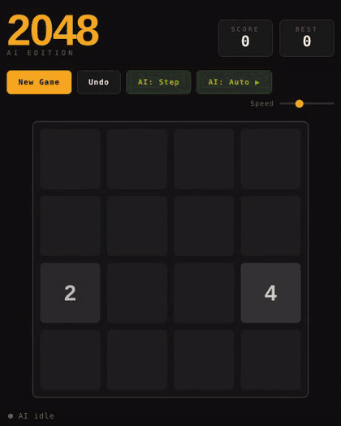

# 2048 AI — Expectimax agent

[](https://github.com/SrivArchit/ETT/actions/workflows/ci.yml)

**Live demo:** https://archit.pythonanywhere.com

A browser version of 2048 with a built-in AI player. Play it yourself, or let the AI take over: an Expectimax search in Python picks every move, and finished games go onto a shared leaderboard.



## Features

- **Play or watch**: arrow keys or WASD for you; **AI: Step** for one AI move, or **AI: Auto** with an adjustable speed (50–800 ms per move)
- **Undo** and automatic save of the current game in the browser
- **Leaderboard**: top 10 scores stored in SQLite, with name validation on the server
- **Docker image** served with gunicorn

## How the AI works

[`App/Ai/ai_player.py`](App/Ai/ai_player.py) runs an **Expectimax** search:

- **Max nodes** try the four moves (up, down, left, right) and skip any move that doesn't change the board.
- **Chance nodes** average over every empty cell, with a new tile being a 2 (90%) or a 4 (10%), the same odds as the game.
- At the default depth of 3 it looks at: its move → every possible new tile → its next move, then scores the board.

Each board is scored with a weighted heuristic:

| Feature | Weight | What it rewards |
|---|---|---|
| Empty cells | 27.0 | Room to keep playing |
| Largest tile (log₂) | 1.0 | Progress |
| Monotonicity | 1.5 | Rows and columns that rise or fall steadily |
| Smoothness | 0.1 | Neighbours with similar values, which merge easily |
| Merge potential | 1.0 | Equal tiles side by side |

A position with no moves left scores −∞.

## Benchmark

[`bench.py`](bench.py) plays full games headlessly with the same rules as the web game and lets the AI choose every move.

Results for 100 games (depth 3, seeds 0–99):

| Metric | Result |
|---|---|
| Reached the 1024 tile | 68% of games |
| Reached the 2048 tile | 10% of games |
| Average score | 13,507 |
| Median score | 12,868 |
| Best score | 35,944 |
| Average game length | 798 moves |
| Average time per move | ~5 ms (2-core machine, CPython 3.13) |

Reproduce it with:

```bash
python bench.py --games 100
```

or run the **AI benchmark** workflow from the repository's Actions tab.

## Architecture

| Part | File | Role |
|---|---|---|
| Game + UI | `App/static/game.js`, `App/templates/index.html` | Game engine, rendering, undo, AI controls and leaderboard UI |
| API | `App/app.py` (Flask) | `POST /ai_move` returns the AI's move for a board · `POST /submit_score` validates and saves a score · `GET /leaderboard` returns the top 10 |
| AI | `App/Ai/ai_player.py` | Board mechanics, heuristic and Expectimax search |
| Storage | `App/Leaderboard/db.py` | SQLite in WAL mode; set `LEADERBOARD_DB_DIR` to keep the file on a mounted volume |

## Run locally

```bash
git clone https://github.com/SrivArchit/ETT.git
cd ETT
pip install -r requirements.txt
cd App
python app.py        # http://localhost:5000
```

With Docker:

```bash
docker build -f dockerfile -t 2048-ai .
docker run -p 5000:5000 2048-ai
```

## Tests and CI

```bash
pip install -r requirements-dev.txt
python -m playwright install chromium   # for the browser tests
pytest
```

The tests cover the slide-and-merge rules, game-over detection, that the AI always returns a legal move, and the Flask endpoints. Browser tests (Playwright) check that `game.js` moves tiles exactly the way the AI's own rules say, so the AI on the page plays the game it is planning for. GitHub Actions runs everything on every push and pull request, plays a 5-game benchmark and checks that the Docker image builds.

## Team

- **Archit Srivastava**: game engine, Expectimax AI, Flask backend and leaderboard
- **Kshitiz Anand**: Docker fixes and score-submission fixes
- **Lakshya Chauhan**: first version of the README

## License

[MIT](LICENSE)
